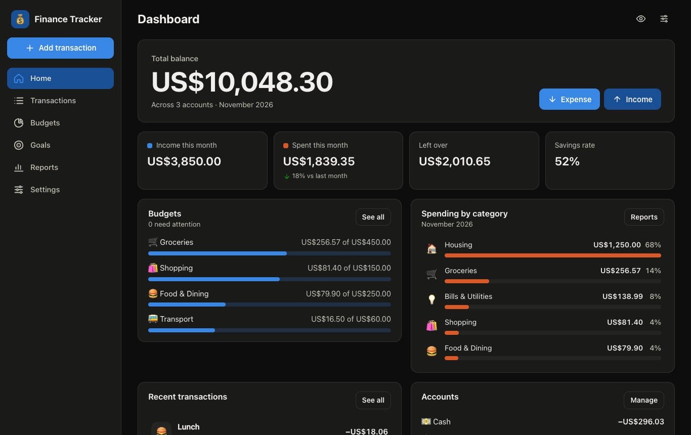
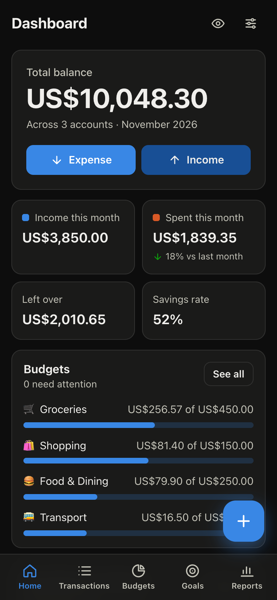

# My First Claude Project

## Purpose

This project is a place to learn and practice. Its goal is to help me get comfortable with:

- **Claude Code**: an AI assistant that runs in the terminal and helps write and edit code
- **Git**: a tool that keeps track of changes to files over time
- **GitHub**: a website where projects saved with Git can be stored and shared online

## Introduction

Welcome! 👋

This is my very first project using Claude Code and GitHub. I'm just getting started, so everything here is part of the learning process.

As I learn, I'll add new files and try out new ideas. Each change will be saved with Git, so you can look back and see how the project grew step by step.

If you're also new to coding, I hope this project shows that everyone starts somewhere. Thanks for stopping by!

## What I've built so far

### 💰 Finance Tracker

A website for keeping track of your money. With it you can:

- Record income, expenses and transfers between accounts
- Set monthly budgets and see how close you are to each limit
- Create savings goals and track your progress
- See charts and reports of where your money goes
- Lock the website with a PIN and hide amounts on screen for privacy
- Install it on your phone or computer like an app, and use it without internet

Your data is stored only in your own browser. Nothing is sent to a server.

<p>
  
  
</p>

<em>Screenshots use the website's built-in demo data, not real finances.</em>

**Try it live:** https://responsetrain16-blip.github.io/my-first-claude-project/expense-tracker/

You can also open `expense-tracker/index.html` on your computer. There's nothing to install. See the [Finance Tracker README](expense-tracker/README.md) for details.

### 🧪 Tester plugin for Claude Code

A Claude Code **plugin** (a package of add-ons you can install into Claude Code) that tests the Finance Tracker for me. It checks adding, editing and deleting transactions, input validation, calculations, monthly summaries and the layout, then reports any problems without changing the code.

To use it, type `/test-tracker` in Claude Code, or just ask it to "test the expense tracker".

It's already switched on inside this project. To install it anywhere else, run this in Claude Code:

```
/plugin install expense-tracker-tester --marketplace responsetrain16-blip/my-first-claude-project
```

### 🔍 PR check plugin for Claude Code

A plugin that reviews a **pull request** (a request to add changes to the project) before it's merged, or my own changes before I push them. It follows 10 review steps:

1. **Understand the PR:** what is it supposed to do?
2. **Review changed files:** which files were added, changed or deleted, plus automatic checks for unwanted files and typing mistakes
3. **Check code changes:** wrong logic, repeated code, bugs, and the project's rules
4. **Verify functionality:** try the change in a real browser, on phone and computer sizes
5. **Check validation:** bad input is rejected with a clear message
6. **Check existing features:** the tester plugin's checks still pass
7. **Check security:** no passwords or keys, and money data never sent over the internet
8. **Run tests:** every test is actually run, with the numbers recorded
9. **Check documentation:** the docs still match the website
10. **Prepare review report:** summary, files reviewed, passed and failed checks, issues and suggestions

It finishes with a final recommendation: ✅ **Approve**, ❌ **Request Changes** or 🔍 **Needs Further Review**. It never marks a check as passed without verifying it, never approves on its own, and never changes code itself.

To use it, type `/pr-check` in Claude Code, followed by a PR number (e.g. `/pr-check 3`), a branch name, or nothing to check your current changes. Or just ask "check this PR".

To install it anywhere else:

```
/plugin install pr-check --marketplace responsetrain16-blip/my-first-claude-project
```

### 💬 Explain simply plugin for Claude Code

A plugin that makes Claude explain technical topics in plain English for a non-technical person. Every answer starts with a one-sentence explanation, uses an everyday comparison, avoids jargon (or explains it in brackets) and ends with "The one thing to remember".

To use it, just ask "what is…" or "explain…", or type `/explain-simply` followed by a topic.

To install it anywhere else:

```
/plugin install explain-simply --marketplace responsetrain16-blip/my-first-claude-project
```

### 📊 Smart Expense Analyst plugin for Claude Code

A plugin that reads my Finance Tracker data and writes a spending report: totals, spending by category, this month compared with last month, unusual or possibly duplicated transactions, and three practical ways to save. It only uses the real data, never invents numbers and never changes anything.

Because the data lives only in my browser, I first give it a file: either **Settings → Download backup** (best) or **Transactions → Export CSV**. Then I ask "analyse my spending" and tell it where the file is. The file stays on my computer.

To install it anywhere else:

```
/plugin install smart-expense-analyst --marketplace responsetrain16-blip/my-first-claude-project
```

## Recent changes

A short summary of each change, newest first. Claude Code adds a line here automatically after making changes (see "Hooks" below).

- **2026-11-24:** Added two Claude Code hooks: one checks the website's JavaScript for typing mistakes after every edit, the other keeps this "Recent changes" list up to date.
- **2026-11-23:** Added the Smart Expense Analyst plugin, which turns a backup of your Finance Tracker data into a spending report with savings ideas.
- **2026-11-23:** Added the explain simply plugin, so Claude explains technical topics in plain English.
- **2026-11-17:** The Finance Tracker now rejects dates more than a year in the future (catches typos like 2062), and error messages scroll fully into view on small screens.

### 🪝 Hooks

Hooks are automatic "whenever X happens, do Y" rules for Claude Code, set in `.claude/settings.json`:

| Hook | When it runs | What it does |
|------|--------------|--------------|
| **JavaScript check** | After Claude edits a file in `expense-tracker/js/` | Checks the file for typing mistakes and tells Claude to fix any it finds |
| **README reminder** | When Claude finishes a task | If files changed but this README didn't, asks Claude to add a one-line summary to "Recent changes" |

Type `/hooks` in Claude Code to see, change or switch them off.

## Project files

| File or folder | What it is |
|----------------|------------|
| `README.md` | This introduction |
| `expense-tracker/` | The Finance Tracker website |
| `ARCHITECTURE.md` | How the Finance Tracker is built, explained for beginners |
| `TESTING.md` | How to test the Finance Tracker |
| `CONTRIBUTING.md` | How others can report bugs and suggest changes |
| `docs/adr/` | Decision records (ADRs): notes explaining big decisions about how the project is built |
| `docs/screenshots/` | Pictures of the website used in this README |
| `CLAUDE.md` | Notes that help Claude Code work on this project |
| `.claude/settings.json` | Project settings for Claude Code: which plugins are on, and the hooks |
| `.claude/hooks/` | The two hook scripts (JavaScript check and README reminder) |
| `plugins/expense-tracker-tester/` | The tester plugin (its skill, `/test-tracker` command and test script) |
| `plugins/pr-check/` | The PR check plugin (its skill and automatic checks script) |
| `plugins/explain-simply/` | The explain simply plugin (one skill that explains technical topics in plain English) |
| `plugins/smart-expense-analyst/` | The Smart Expense Analyst plugin (one skill that analyses a backup or CSV export and suggests savings) |
| `.claude-plugin/marketplace.json` | Lists the plugins so Claude Code can install them from this repository |
| `LICENSE.md` | The MIT License |

## License

This project is shared under the [MIT License](LICENSE.md). That means anyone can use, copy, change and share the code, as long as they keep the copyright notice and the license text with it.
